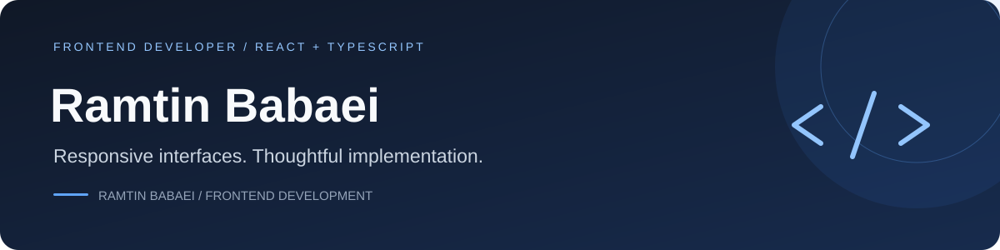

<p align="center">
  
</p>

<p align="center">
  <a href="#selected-projects">Projects</a> ·
  <a href="#technical-focus">Toolbox</a> ·
  <a href="#how-i-work">How I work</a> ·
  <a href="#education">Education</a> ·
  <a href="https://www.linkedin.com/in/ramtin-babaei">LinkedIn ↗</a>
</p>

# Ramtin Babaei


**Frontend Developer · React · TypeScript**

I turn designs and product ideas into responsive web interfaces. I have **one year of hands-on frontend development experience**, with a focus on reusable components, clear application state, and dependable API integration.

I enjoy the details that make an interface feel complete: useful feedback, keyboard-friendly controls, and layouts that work on a small screen. I collaborate with backend developers and have foundational knowledge of **Node.js, Express.js, and SQL**.

**[Explore my work ↓](#selected-projects)** · **[LinkedIn ↗](https://www.linkedin.com/in/ramtin-babaei)** · **[Personal portfolio — source ↗](https://github.com/RamtinBabaei/personal-portfolio)**

<br clear="right" />

```yaml
focus: responsive React interfaces
collaboration: product, design, and backend teams
workflow: understand → build → review → test → refine
open_to: frontend roles and web development collaborations
```

## Selected projects

The projects below show how I approach application state, responsive layouts, API integration, and complete user flows.

| Project | Demo | What to explore | Main technologies |
| --- | --- | --- | --- |
| [FlowBoard](https://github.com/RamtinBabaei/flowboard-saas-3.) | [Live demo](https://ramtinbabaei.github.io/flowboard-saas-3./) | Workspace state, Kanban/list/calendar views, task filters, and browser persistence | React, TypeScript, Recharts, Zod, IndexedDB |
| [ShopSphere](https://github.com/RamtinBabaei/ShopSphere) | [Live demo](https://ramtinbabaei.github.io/ShopSphere/) | Catalog integration, persistent shopping state, forms, and a complete demo purchase journey | React, TypeScript, Tailwind CSS, TanStack Query, Zustand |
| [Coursefar](https://github.com/RamtinBabaei/coursefar) | [Live demo](https://ramtinbabaei.github.io/coursefar/) | Persian RTL UI, three user roles, typed API integration, and separate static/API-backed modes | React, TypeScript, Express, SQLite |
| [Audiophile Studio](https://github.com/RamtinBabaei/audiophile-studio) | [Live demo](https://audiophile-studio.ramtinbabaei-portfolio.workers.dev/) | Responsive storefront, persistent cart, typed checkout, and database-backed demo orders | React, TypeScript, Tailwind CSS, Cloudflare D1 |
| [Designo Studio](https://github.com/RamtinBabaei/designo-studio) | [Live demo](https://designo-studio.ramtinbabaei-portfolio.workers.dev/) | Seven responsive pages, reusable layouts, accessible dialogs, and a persistent contact API | React, TypeScript, Tailwind CSS, Cloudflare Workers |

### Recent builds

| Project | What to explore | Main technologies |
| --- | --- | --- |
| [NoteFlow](https://github.com/RamtinBabaei/noteflow) | [Live demo](https://noteflow.ramtinbabaei-portfolio.workers.dev) | Notes editor, search and tags, themes, unsaved-change handling, and database-backed guest workspaces | React, TypeScript, Tailwind CSS, Zod, D1 |
| [QuickDine](https://github.com/RamtinBabaei/quickdine-platform) | [Live demo](https://quickdine-platform.ramtinbabaei-portfolio.workers.dev) | Restaurant discovery, reservation flows, and separate diner, owner, and administrator workspaces | React, TypeScript, Tailwind CSS, Workers, D1 |
| [Photosnap Studio](https://github.com/RamtinBabaei/photosnap-studio) | [Live demo](https://photosnap-studio.ramtinbabaei-portfolio.workers.dev) | Editorial layouts, story readers, plan comparison, prerendered routes, and an invitation API | React, TypeScript, React Router, Tailwind CSS, D1 |
| [Prescripto](https://github.com/RamtinBabaei/prescripto-platform) | [Live demo](https://prescripto.ramtinbabaei-portfolio.workers.dev) | Specialist discovery, appointment flows, patient and staff interfaces, and typed API state | React, TypeScript, Tailwind CSS, TanStack Query, D1 |

Each repository describes its architecture, local setup, validation commands, and current scope. These are portfolio applications; demo bookings, orders, and account behavior are explained in their documentation.

**[Browse all repositories ↗](https://github.com/RamtinBabaei?tab=repositories)**

## Technical focus

### Frontend

<p>
  
  
  
  
  
</p>

### Styling & UI

<p>
  
  
  
  
</p>

### State, data & quality

<p>
  
  
  
  
  
</p>

### Development & delivery

<p>
  
  
</p>

| Area | Tools and practices |
| --- | --- |
| Frontend | React, TypeScript, JavaScript, HTML5, CSS3, responsive design |
| Styling and UI | Tailwind CSS, Sass/SCSS, Bootstrap, Figma-to-interface implementation |
| Application development | React Router, REST API integration, form validation, loading and error states |
| Quality and delivery | Git, GitHub, GitHub Actions, debugging, TypeScript checks, automated tests |
| Backend foundations | Basic Node.js, Express.js, SQL, and relational database concepts |

## How I work

- **Start with the interface:** understand the layout, user journey, and behavior before building components.
- **Build for real use:** cover mobile layouts, validation, keyboard interaction, loading, empty, and error states.
- **Work across the API boundary:** coordinate payloads, contracts, and error handling with backend developers.
- **Review before delivery:** check generated code, types, tests, and production builds; keep documentation useful for the next developer.

## Education

**B.Sc. in Computer Engineering** · Islamic Azad University, Babol · 2021–2025

---

Have a frontend role or a web project in mind? **[Let’s connect on LinkedIn ↗](https://www.linkedin.com/in/ramtin-babaei)**

<sub>Thoughtful interfaces. Clear code. Continuous improvement.</sub>
